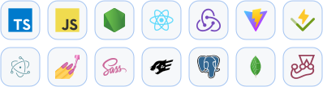

    <!-- https://github.com/DenverCoder1/readme-typing-svg -->
    

    
    <!-- https://github.com/jwenjian/visitor-badge -->
    

    <!-- https://github.com/anuraghazra/github-readme-stats -->
    
    <!-- https://github.com/DenverCoder1/github-readme-streak-stats -->
    

<h2 align="center">
    
    Stuff I ship with
</h2>

    

<h2 align="center">
    
    Keeping servers alive
</h2>

    

<h2 align="center">
    
    Poking at binaries
</h2>

    

<h2 align="center">
    
    Messing around with
</h2>

    

    <picture>
        <source media="(prefers-color-scheme: dark)" srcset="https://raw.githubusercontent.com/JeViCo/JeViCo/refs/heads/output/skyline-dark.svg" />
        
    </picture>

